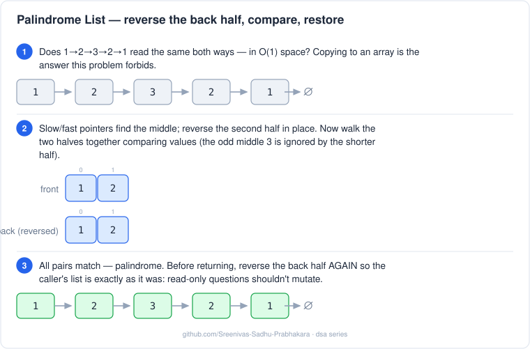

# Palindrome Linked List

> Striver SDE Sheet 034 · Day 6 Linked List — middle via slow/fast, reverse the back half, compare, then reverse it back so the caller's list survives. Go, stdlib only, tested.

## Problem

Check whether a singly linked list reads the same forwards and backwards, in O(n) time and O(1) space — copying values into a slice is the O(n)-space answer this problem exists to forbid.

## Approach

Three reusable list moves composed: (1) slow/fast pointers find the end of the first half; (2) the second half is reversed in place; (3) two pointers walk the halves together comparing values — driven by the second half's pointer, which neatly ignores the middle node of odd-length lists. Because mutating your caller's data structure as a side effect of a *read-only question* is rude, the second half is reversed back before returning; the restore is verified by its own test.

**Complexity:** O(n) time, O(1) space.

## Visual walkthrough

Read the picture top to bottom — each numbered frame is one moment of the algorithm
running on this repo's test example.

## Run

    go test ./...   # verify
    go run .        # demo

---

One of 191 repos solving Striver's SDE Sheet in Go — stdlib only, one problem per repo, every solution tested. Browse the set: [`dsa-*` repos](https://github.com/Sreenivas-Sadhu-Prabhakara?tab=repositories&q=dsa-&type=source).
